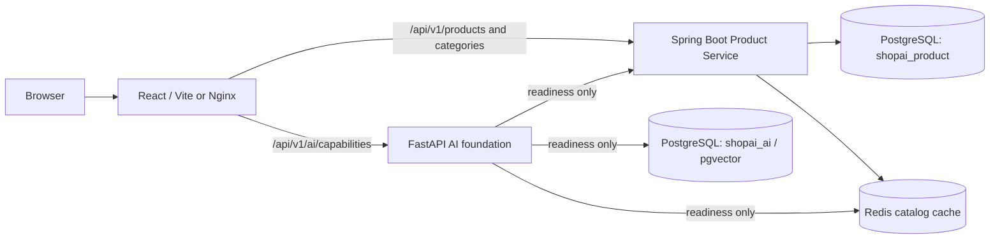
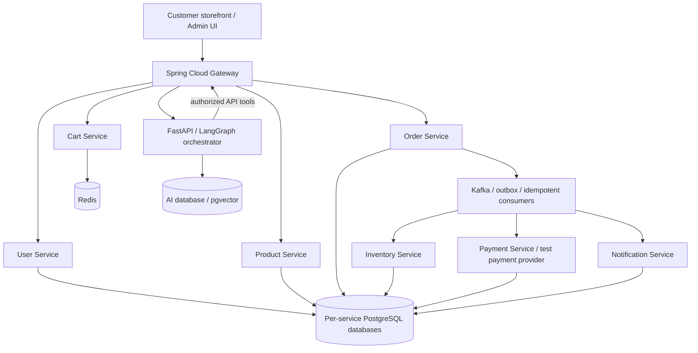

# ShopAI

**Good finds. Better everyday.** An original e-commerce platform being built in verified phases with React, Java microservices, and a separate AI orchestration service.

## Phase 1 scope

This phase establishes the runnable foundation. The storefront reads **actual PostgreSQL records through the Product Service**. Development fixtures provide eight sample products; they are not live inventory, real reviews, or purchasable offers. No frontend fallback data or simulated chat is used.

Implemented:

- Responsive React/TypeScript storefront, product listing and details, URL-based search, categories, price filters, sorting, pagination, loading/error/empty states, and accessible navigation.
- Spring Boot 3.5 / Java 21 Product Service with JPA, Bean Validation, read-only Spring Security rules, restricted CORS, correlation IDs, and health probes.
- Flyway-owned catalog schema, PostgreSQL service accounts, Redis catalog caching with a two-minute TTL and database fallback on cache failure.
- FastAPI shopping assistant and catalog recommendations, with budget-aware conversations, browser-based homepage personalization, complementary product picks, and optional OpenAI intent extraction. Review, support, and inventory agents remain planned.
- Dockerfiles, five-service Compose stack, isolated native development scripts, automated tests, smoke checks, and CI configuration.

Not implemented yet: accounts/JWT, catalog mutations, carts, inventory, orders, checkout, payments, Kafka, notifications, embeddings, admin analytics, or AWS deployment. Reserved directories mark the planned architecture; they do not contain dummy services.

## Architecture

Current, Phase 1:



Target architecture, delivered in later phases:



The Phase 1 reverse proxy is transport routing only. It does not stand in for the future authenticated gateway. Each future service owns its writes and migrations. Inventory and payment truth stays in PostgreSQL. Planned order coordination reserves inventory before initiating payment, uses outbox events and idempotent consumers, and releases reservations on failure. See [architecture](docs/architecture.md).

## Layout

```text
shopai/
  frontend/shopai-web/          React storefront, Nginx config, tests
  backend/product-service/     Java catalog application, migrations, tests
  backend/{api-gateway,user-service,cart-service,order-service,
           inventory-service,payment-service,notification-service}/
                               Reserved; implemented in later phases
  ai-services/ai-orchestrator/  FastAPI foundation, dependency probes, tests
  infrastructure/              PostgreSQL bootstrap; other areas reserved
  docs/                        Architecture, API, schema, setup, phase report
  scripts/                     Local secrets, native processes, smoke tests
  .github/workflows/ci.yml      Build, integration and browser checks
  docker-compose.yml           Current five-service foundation
```

Empty future directories exist locally but Git does not retain empty directories. The complete directory map is in [the Phase 1 report](docs/phase-1.md). Source files are listed individually in [the file manifest](docs/files.md).

## Quick start with Docker

Requirements: Docker Engine/Desktop with Compose v2. No Java, Python, Node, OpenAI key, AWS credentials, or payment credentials are required on the host for Docker startup. Python 3 is used only by the optional environment generator and smoke helper; alternatively copy `.env.example` to `.env` and replace its local password placeholders.

Run from this `shopai` directory:

```bash
python3 scripts/init-env.py
docker compose config --quiet
docker compose up --build -d --wait --wait-timeout 240
python3 scripts/smoke.py
```

Open [ShopAI](http://localhost:5173), [Product readiness](http://localhost:8081/actuator/health/readiness), [AI readiness](http://localhost:8000/health/ready), and [FastAPI OpenAPI docs](http://localhost:8000/docs).

Expected: eight development catalog products, four categories, healthy readiness probes, and available shopping/recommendation capabilities. `llm_enabled` reports whether the optional server-side model key is configured. First image/build downloads may take several minutes. A smoke check prints `PASS` only after live requests and dependency checks succeed.

```bash
docker compose logs --tail=100 -f
docker compose down
```

Named volumes preserve data across `down`. Removing volumes destroys local records and should only be done when deliberately resetting your development environment.

## Native development

Requirements: Node **22.12+**, Java **21**, Maven **3.6.3+**, Python **3.12+**, PostgreSQL **17**, and Redis. Java 21 is selected automatically by Make/scripts when installed through Homebrew on Apple Silicon. See [setup](docs/setup-guide.md) for installation and per-service commands.

```bash
make env
make install
make native-infra
make build
make native-up
make smoke
make native-test
make e2e
make native-down
```

After the initial install/build, run `npm run dev` from the outer folder or `bash scripts/dev.sh` from this directory. It starts the native dependencies and APIs, waits for readiness, and launches Vite. See [shopping assistant setup](docs/shopping-assistant.md).

Native infrastructure has its own cluster under ignored `.local/`, binds to loopback, and requires passwords. It never starts or changes an existing PostgreSQL cluster. Default ports must be free. Use either Docker infrastructure or native infrastructure, not both on the same ports.

## Configuration and database setup

`.env.example` explains every variable. `scripts/init-env.py` creates unique local secrets in a mode-600 `.env` without overwriting an existing one. No secret is bundled in React. The example values are local placeholders only. Hex passwords avoid URL escaping issues; percent-encode special characters if manually composing database/Redis URLs.

PostgreSQL initialization creates separate `shopai_product` and `shopai_ai` database owners; neither service uses the bootstrap superuser. pgvector is enabled in the AI database by Docker bootstrap. Flyway creates `categories`, `products`, `product_images`, and `product_specifications`. The explicit **dev** profile adds sample data with a separate migration; default/no-profile deployments do not seed. Use a fresh production database, not a database previously migrated with development fixtures. See [database schema](docs/database-schema.md).

Redis stores disposable catalog DTO caches. Keys use the `shopai:catalog:v1:` namespace, expire in 120 seconds, and never substitute for stock/payment truth. Catalog writes are not exposed; Phase 2 must invalidate affected caches when writes arrive.

## API

Public, read-only Phase 1 endpoints:

- `GET /api/v1/products` — `q`, `category`, `minPrice`, `maxPrice`, `featured`, `page`, `size`, `sort`.
- `GET /api/v1/products/{uuid}` — product, images and specifications.
- `GET /api/v1/categories` — catalog categories.
- `GET /actuator/health/{liveness,readiness}` — Product Service health.
- `GET /api/v1/ai/capabilities` — planned agents and actual availability.
- `POST /api/v1/ai/chat` — shopping conversation with real catalog picks and price limits.
- `POST /api/v1/ai/recommendations` — homepage and complementary product recommendations.
- `GET /health/{live,ready}` — AI process/dependency health.

Example:

```bash
curl 'http://localhost:5173/api/v1/products?category=electronics&maxPrice=7000&sort=price-asc'
curl 'http://localhost:5173/api/v1/ai/capabilities'
```

Catalog errors use HTTP 400/404 Problem Details. All mutations are denied. [Full contracts](docs/api-documentation.md).

## Testing

```bash
make install
make test          # Java integration tests start PostgreSQL/Redis via Testcontainers; requires Docker
make build
make smoke         # requires running full development stack
make e2e           # requires running APIs; uses installed Google Chrome
```

With native infrastructure running, use `make native-test` instead of `make test`. It uses the **separate** `shopai_product_test` database and Redis DB 15. It never replaces the storefront database. To install the browser on CI/Linux: `cd frontend/shopai-web && npx playwright install --with-deps chrome`.

Tests cover query validation, actual database filtering/sorting/pagination, details, schema constraints, denied writes, restricted origins, cache round trips/expiry, dependency failures, UI query state, and a real browser catalog journey. Later-phase payment/auth/concurrency/event/agent tests will accompany their implementations. Local results and limitations appear in [the Phase 1 report](docs/phase-1.md); a workflow file alone does not mean CI has run remotely.

## Deployment and operations

The Compose stack is a local foundation, not a production deployment. Containers run application processes as non-root, expose host ports on loopback, and use health checks and persistent volumes. [AWS preparation](docs/deployment-guide.md) maps services to ECS/RDS/ElastiCache/MSK without claiming any cloud resources were deployed. OpenTelemetry, Prometheus and Grafana are planned in Phase 7.

## Troubleshooting

- **Java version error:** select Java 21 with `export JAVA_HOME=/opt/homebrew/opt/openjdk@21/libexec/openjdk.jdk/Contents/Home` on Apple Silicon or your installed JDK 21 path.
- **Docker unavailable:** start Docker Desktop/Engine or follow native setup. Installing the Docker CLI alone does not provide an engine.
- **Ports in use:** stop the other stack. Compose ports are configurable in `.env`; native scripts also read port variables, and service URLs must match them.
- **Database password changed after initialization:** existing volumes keep existing roles/passwords. Update the database role intentionally or restore the matching local `.env`; editing `.env` does not rotate database credentials.
- **Empty catalog:** run with `SPRING_PROFILES_ACTIVE=dev` against a development database. No frontend fixtures conceal an unavailable/empty API.
- **Redis unavailable:** product reads fall back to PostgreSQL; readiness remains unhealthy because the configured foundation dependency is down.
- **Images unavailable:** sample photos are loaded from Unsplash over the network. They are illustrative development assets; production uploads and S3 arrive later.
- **Shopping assistant unavailable:** check `/health/ai/ready` and `.local/ai.log`. The assistant requires a reachable Product Service and never substitutes invented products. Without an OpenAI key it uses catalog matching; [configuration and limits](docs/shopping-assistant.md).

Next phase: User Service, authentication/JWT, protected admin product CRUD, and richer catalog filtering. Stop after this foundation until Phase 2 is requested.
